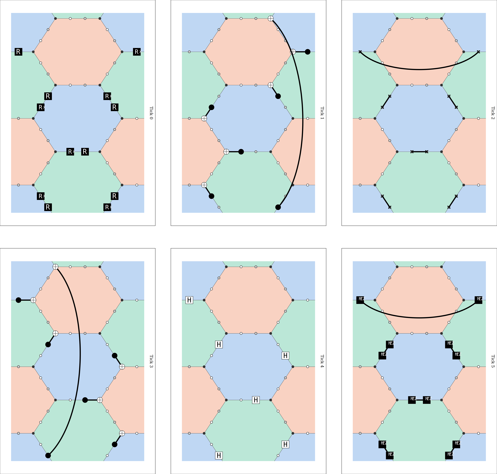
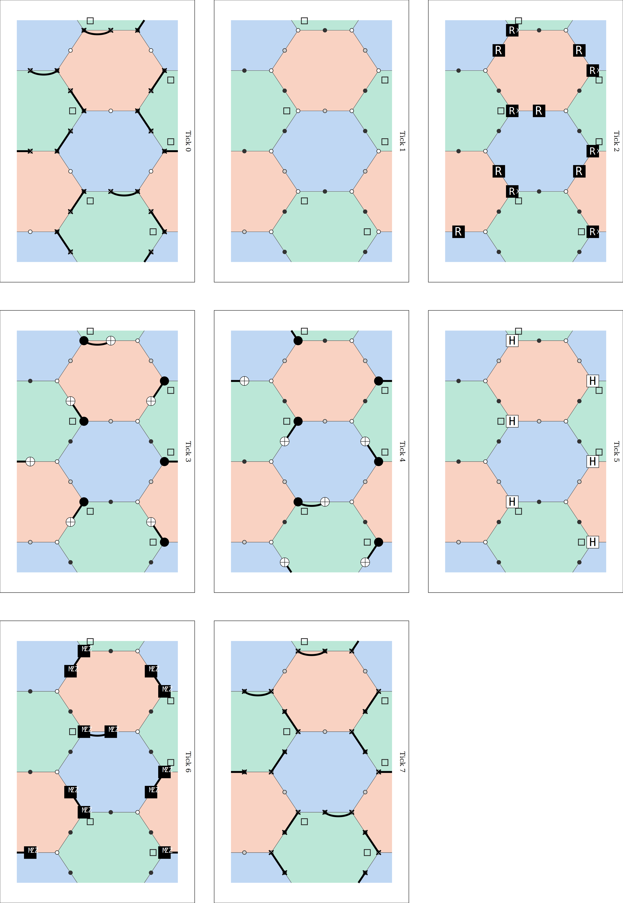
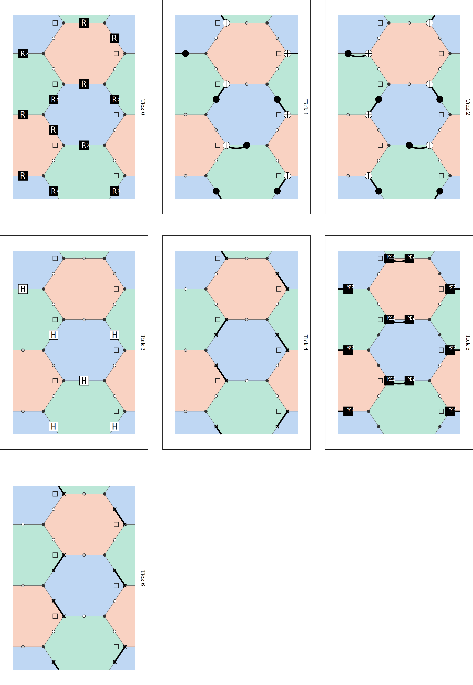
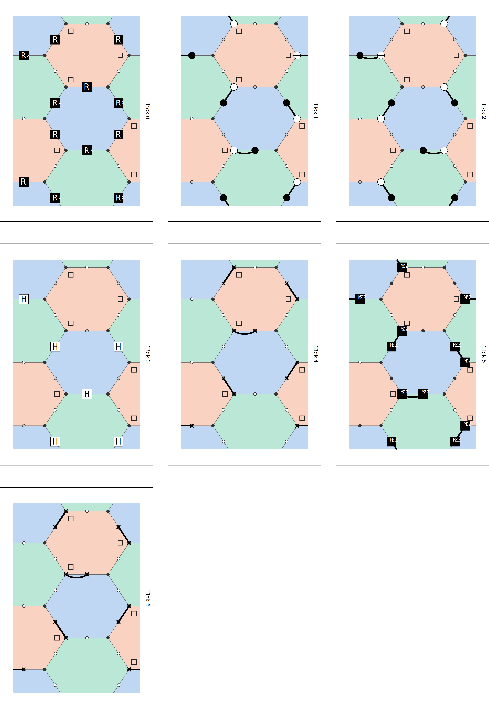

# Floquet honeycomb code with spin-qubit readout

Memory experiments for the Floquet honeycomb code, with readout through spin ancillas. The code compares
several readout schemes:

- **pairs**: a syndrome and a reference ancilla on every edge (`src/two_ancillas/`)
- **pairs_bell**: pairs, but each ancilla pair starts as a Bell pair instead of being SWAPped
- **method_a / method_b / method_c**: one ancilla per edge, read out at a corner of a hex, following
  hexes.pdf (`src/single_ancilla/method_*/`)

Every scheme goes through the same `floquet.memory_circuit`, noise model and decoder (Stim + PyMatching), so the
only thing that differs between them is the step circuits.

Every scheme runs two codes, picked by `code=` in `memory_circuit` and each scheme's `round_circuit`:

- **css** (default): the CSS Floquet code, schedule `rX gZ bX rZ gX bZ`
- **x3z3**: the X³Z³ Floquet code (Setiawan & McLauchlan, arXiv:2411.04974), the CSS code with a Hadamard on
  every other column of data qubits. Checks become XX, ZZ, XZ or ZX and plaquettes X³Z³, so Z-biased noise
  is much easier to decode. See `notebooks/x3z3/x3z3.ipynb`.

Step 0 of each scheme at distance 1, one panel per tick (`make drawings`, hex view):

| pairs | method_a |
|---|---|
|  |  |
| **method_b** | **method_c** |
|  |  |

## Setup

```bash
make venv          # .venv with requirements.txt, plus a Jupyter kernel "floquet_code"
make paths         # (run by venv) lists src/'s module folders in .venv, so `import floquet` etc. just work
```

## Running

Every result is a `make` target. Settings can be overridden on the command line, and their defaults are
documented at the top of the [Makefile](Makefile).

| Target | What it makes |
|---|---|
| `make physical-to-logical` | LER vs p for every scheme in `SCHEMES`, in one CSV and one plot |
| `make ler-etas` | LER vs p for `LER_SCHEMES` (default method_b) under both codes, one CSV and plot per η in `LER_ETAS`, in `results/physical_to_logical/<scheme>/` |
| `make plots` | LER vs p for the pairs scheme only, one CSV per distance |
| `make footprint` | LER vs physical qubit count at one `P`, extrapolated to `TARGET`; `FOOTPRINT_CODES="css x3z3"` compares the codes |
| `make x3z3` | X³Z³ vs CSS Floquet code for every scheme under `NOISE`: `x3z3-bias` (threshold and LER vs η) and `x3z3-ler` (LER vs p) |
| `make thresholds` | threshold surface and threshold vs bias for `SCHEME` (after IBM's QEC-with-spin-qubits); `CODE=x3z3` for X³Z³ |
| `make thresholds-all` | `thresholds` for every scheme; `thresholds-medium` / `thresholds-paper` with more shots |
| `make thresholds-x3z3` | `thresholds-all` for X³Z³; `thresholds-x3z3-medium` with more shots |
| `make drawings` | layouts and timeslices for every scheme at `DRAW_DISTANCE` |
| `make docs` | the LaTeX write-ups in `docs/` (needs tectonic) |
| `make serve` | interactive viewer of `results/` (needs node) |

Example:

```bash
make physical-to-logical NOISE=spin ETA=100 DISTANCES="3 5 7" SHOTS=100000
make ler-etas LER_ETAS="10 100" LER_SHOTS=20000000
```

Output file names include their settings, so runs with different settings don't overwrite each other.

Every run collects its data as CSV, one row per point appended as soon as it is computed (`writing.results_csv.run_points`;
`thresholds.py` per point of each scan). A run that crashes or is stopped picks up where it left off when the same
command is run again, and `--plot-only` redraws from the CSV without simulating.

With both codes (`physical_to_logical.py --codes css x3z3`, `footprint.py`, the x3z3 sweep) every point runs the Z and
the X memory, and the plots show p_L = 1 - (1 - p_Z)(1 - p_X): either logical failing. A Z memory alone barely sees
Z-biased noise on the CSS code, so it would make CSS look far better than it is. In these plots X³Z³ markers are
filled and CSS ones hollow. A point with no logical errors is drawn as its 95% upper bound with an arrow down.
`--max-errors` stops a point early once it has that many logical errors, so high-p points don't use all the shots.

## Layout

```
src/shared/           floquet.py (lattice, memory_circuit), noise.py (spin / HBD), memory.py (decoding),
                      drawing.py (timeslice helpers), writing/results_csv.py (resumable result CSVs): used by
                      every scheme and experiment
src/two_ancillas/     pairs.py (step circuit), plots.py
src/single_ancilla/   shared/ (layout.py: one-ancilla lattice, corner_readout.py: corner readout used by B and C),
                      method_a|b|c/
src/experiments/      physical_to_logical.py (LER vs p, and SCHEMES), footprint.py, thresholds.py,
                      x3z3_ler.py + x3z3_bias.py (X³Z³ vs CSS sweep)
notebooks/            walkthroughs of each scheme, of the memory experiment and of the X³Z³ code
results/              all generated output, laid out like src/
docs/                 write-ups: floquet_rounds, decoding, spin_x3z3_readout, one_ancilla_review
viewer/               Vite + React viewer behind `make serve`
```
